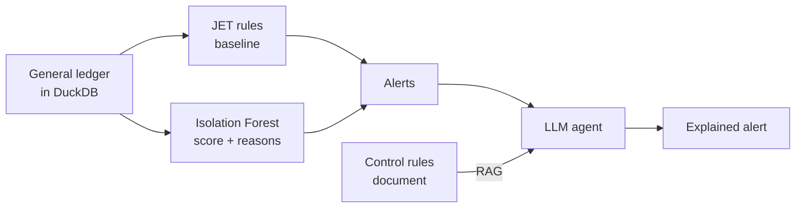

# AI-ledger-guard

AI-powered journal entry testing: anomaly detection on general ledger data, with an LLM agent that explains every alert.

**Status:** work in progress, started in October 2026. Currently in phase 1 (data and anomaly model).

## Why this project

Journal entry testing (JET) is a standard audit procedure: auditors examine the entries in a general ledger to find errors and fraud. Most JET today relies on fixed rules, which catch known patterns but miss the ones nobody anticipated.

This project combines three layers: classic JET rules as a baseline, an unsupervised anomaly model that scores every journal entry, and an LLM agent that investigates each alert and explains it in business language.

It builds on my background in financial controlling and ERP development (Microsoft Dynamics NAV / Business Central).

## How it works (planned)



1. **Rule baseline:** classic JET tests such as Benford's law, round amounts, weekend postings and rare account combinations.
2. **Anomaly model:** an Isolation Forest that gives each journal entry a score and the features behind it.
3. **LLM agent:** queries the ledger, calls the model and explains alerts, grounded in a control-rules document through RAG.
4. **Evaluation and deployment:** model metrics against the labels, test cases for the agent, tracing, and deployment on Microsoft Foundry.

## Roadmap

**Phase 1: data and model** (Oct to Nov 2026)

- [x] Project and environment setup
- [ ] Load the ledger into DuckDB and explore it
- [ ] Rule-based baseline
- [ ] Journal-entry features and Isolation Forest
- [ ] Evaluation against the labels (precision@k, PR-AUC) and a scoring function

**Phase 2: LLM agent** (Nov to Dec 2026)

- [ ] Agent tools: data queries, model scoring, alert explanation
- [ ] Validated structured outputs
- [ ] RAG over a control-rules document

**Phase 3: evaluation and production** (Dec 2026 to Jan 2027)

- [ ] Agent test cases and metrics
- [ ] Tracing, cost, latency and prompt-injection checks
- [ ] Deployment on Microsoft Foundry

## Data

A synthetic general ledger with labelled anomalies, built for journal entry testing research and published in *Data in Brief* (2026), [DOI 10.1016/j.dib.2026.113257](https://doi.org/10.1016/j.dib.2026.113257).

Each row is a posting to one account, and complete journal entries are grouped by `posting_id`. The `label` column marks anomalous postings and `marking` links each one to its anomaly scenario.

The data is not versioned in this repository. Only synthetic or public data is used, never real company data.

Dataset: Gronewald, J., Stephan, S., Rombach, A., & Fettke, P. (2026). *DIB General Ledger Data*. Zenodo. https://doi.org/10.5281/zenodo.22014653. Licensed under CC BY 4.0.

## Tech stack

Python 3.12, uv, DuckDB, pandas, scikit-learn, matplotlib and Jupyter. The LLM provider and Microsoft Foundry come in phases 2 and 3.

## Getting started

Requires [uv](https://docs.astral.sh/uv/).

```bash
git clone https://github.com/<your-username>/AI-ledger-guard.git
cd AI-ledger-guard
uv sync
```

Download the dataset from the article above and place the CSV in `data/raw/`. Then start Jupyter:

```bash
uv run jupyter lab
```

## Project structure

```
AI-ledger-guard/
├── data/raw/              # dataset (not versioned)
├── notebooks/             # exploration
├── src/ai_ledger_guard/   # reusable code
├── pyproject.toml         # project and dependencies
└── uv.lock                # exact dependency versions
```

## How this project is built

This is a learning project. I write the code myself and use Claude (Anthropic) as a tutor and code reviewer: it explains concepts and reviews my work, but the core logic is mine.

## Author

Paulo, software developer working on Microsoft Dynamics NAV / Business Central, with a background in financial controlling.
